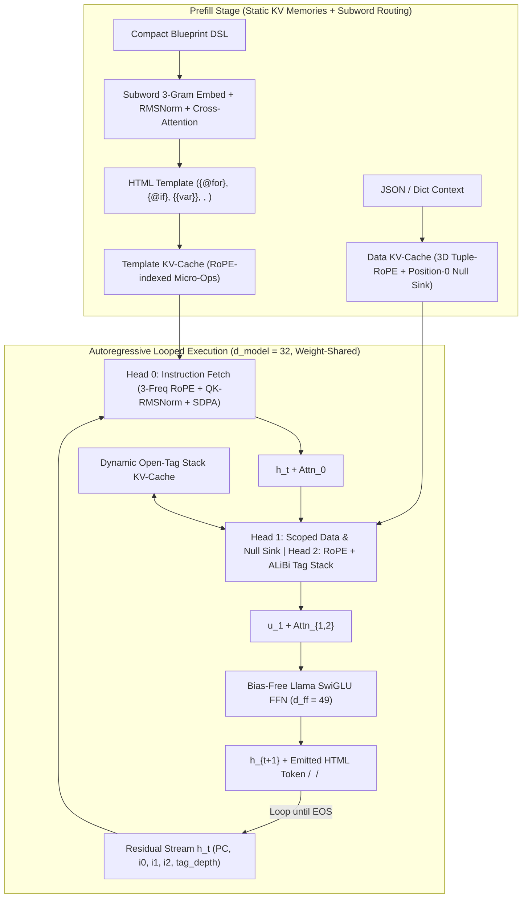

# Carbon CLA-1

**A Sub-Kilobyte, Non-LLM Looped-Attention HTML Template Engine Built 100% From LLM Components.**

[](LICENSE)
[](pyproject.toml)
[-success.svg)](#footprint--benchmarks)

**Carbon CLA-1** (`carbon-html`) is an experimental, deterministic tensor virtual machine (`d_model = 32`, `d_ff = 49`) that both **synthesizes reusable HTML templates** from compact blueprints and **renders HTML templates with up to 3-level nested loops** purely through modern Transformer LLM building blocks—with **zero natural-language training corpus**, **zero hallucinations**, and **zero external template libraries** (no Jinja2, Mustache, Mako, or `string.Template`).

---

## Why Build a Template Engine Out of LLM Components?

Large Language Models bundle billions of statistical parameters with remarkably expressive **architectural primitives**: Rotary Position Embeddings (RoPE), QK-RMSNorm, Scaled Dot-Product Attention over KV-Caches, Attention Sinks, ALiBi recency biases, and SwiGLU gated MLPs.

Drawing on mechanistic interpretability and neural compilation (*RASP*, *Tracr*, and *Looped Transformers as Programmable Computers*), **Carbon CLA-1** asks: *how small can an exact, loop-capable HTML template creator and renderer be if we keep the Transformer components and throw away the LLM?*

- **Not an LLM**: No stochastic sampling, no text pretraining, no context degradation across 300+ loop iterations, and zero mismatched closing tags.
- **100% Genuine PyTorch LLM Layers**: Every loop iteration, conditional jump, variable lookup, and LIFO HTML closing tag executes inside a single weight-shared `CarbonBlock` (`h_{t+1} = CarbonBlock(h_t, kv_cache)`).

---

## Architecture



### How Each LLM Component Works Inside `CarbonBlock`

| LLM Component | Origin | Mechanistic Role in Carbon CLA-1 |
|---|---|---|
| **`RotaryEmbedding` (RoPE)** | Su et al., 2021 (*Llama / Qwen / Gemma*) | Encodes `PC`, 3D loop indices `(i0, i1, i2)`, scope/field IDs, and HTML tag depth across 3 frequencies (`π/8, π/128, π/2048`) so `Q · K` hits a unique `1.0` peak across `4,096` positions. |
| **`RMSNorm` (QK-Norm)** | Zhang & Sennrich, 2019 (*Gemma 2/3, Qwen 3*) | Normalizes queries, keys, and subword n-gram vectors to invariant root-mean-square scale prior to dot-product attention. |
| **Null Attention Sink** | Xiao et al., 2023 (*StreamingLLM*) | Position-0 `[NULL_SINK]` entry in `K_data` has dot-product score `4.98725`—strictly below an exact match (`5.0000`) and strictly above any mismatch (`≤ 4.9745`)—cleanly catching `idx == len(list)` loop exits and missing optional keys. |
| **`ALiBiRecencyBias`** | Press et al., 2022 (*ALiBi*) | Applies `-slope * Δstep` recency bias over open HTML tags at the target nesting depth so `</>` and `</*>` pop tags in exact LIFO stack order, even when dynamic branches (`<strong>` vs `<em>`) alternate inside loops. |
| **`SwiGLU` FFN** | Shazeer, 2020 (*Llama-3*) | Bias-free `(silu(x @ W_gate) * (x @ W_up)) @ W_down` using $G = S(\sum_{m=1}^k b_m - (k-1))$ so `k`-input `AND` gates evaluate to `1.0000000` (true) or `0.0000000` (false) in `float32`. |
| **`SubwordNGramEmbedding`** | Character Subword Encoders | Hashes character 2/3-grams + subword roots into a quasi-orthogonal sinusoidal basis so fuzzy component names (`kpi_grid`, `datagrid`, `hero_banner`, `colophon`) route accurately to HTML archetypes. |

---

## Footprint & Benchmarks

| Metric | Value |
|---|---|
| Residual stream width (`d_model`) | `32` floats |
| SwiGLU intermediate width (`d_ff`) | `49` neurons (`23` logic + `26` scratch cleanup) |
| **Active nonzero matrix weights** | **`213`** (`852 bytes` in sparse `(row, col, fp16)` COO) |
| Total nonzero parameters (incl. `RMSNorm`) | `303` |
| Total dense parameters | `5,818` (`11,636 bytes` dense `fp16`) |
| Compressed PyTorch `.pt` checkpoint (`zlib`) | **`1,915 bytes`** (`< 2 KB`) |
| Max nested loop depth | `3` levels (`O(1)` residual state independent of list length) |

---

## Installation

Using [`uv`](https://github.com/astral-sh/uv) (recommended) or standard `venv` + `pip`:

```bash
git clone https://github.com/recursive-ai-dev/carbon-cla-1.git
cd carbon-cla-1

uv venv .venv
uv pip install --python .venv/bin/python torch numpy pytest
uv pip install --python .venv/bin/python --no-build-isolation --no-deps -e .
```

---

## Quickstart

### 1. Python API: Loop Rendering & Blueprint Synthesis

```python
from carbon_html import CarbonEngine

engine = CarbonEngine()

# A) Render a handwritten HTML template with nested loops, conditionals, & stack auto-close
template = """
<section class="roster">
  <h1>{{org}}</h1>
  <ul>
  {@for team in teams}
    <li>
      <strong>{{team.name}}</strong>:
      {@for member in team.members}
        <span>#{{@num}} {{member}}{@if @not_last}, {@end}</>
      {@end}
    </>
  {@end}
  </*>
"""

result = engine.render(template.strip(), {
    "org": "Carbon Systems",
    "teams": [
        {"name": "Attention", "members": ["Ada", "Linus"]},
        {"name": "EmptyTeam", "members": []},
        {"name": "FFN", "members": ["Noam"]},
    ],
})
print(result.html)

# B) Create a reusable HTML template from a compact Blueprint (with fuzzy component routing!)
blueprint = """
page title=page_title theme=carbon
topbar(links): brand, href, label
hero_banner: headline, tagline?
kpi_grid(metrics): label, value, delta?
datagrid(events): time, service, status
catalog(cards) [pills=tags]: title, summary
colophon: copyright
"""

synthesized = engine.synthesize(blueprint)
print(synthesized.template)  # Reusable HTML5 template with {@for ...} & {{...}} slots!
```

### 2. Command-Line Interface & Live Tensor Trace

Inspect model byte stats, synthesize templates, or watch every attention head and SwiGLU gate fire step-by-step:

```bash
# Inspect exact parameter & byte counts
.venv/bin/carbon-html stats

# Render with live mechanistic attention & SwiGLU gate trace
.venv/bin/carbon-html render \
  '<ul>{@for x in xs}<li>{{@num}}: {{x}}</>{@end}</*>' \
  -d '{"xs":["RoPE","ALiBi","SwiGLU"]}' \
  --trace
```

Sample `--trace` output:

```text
[step 000] pc=00 op=LIT   loop=(0, 0, 0) depth=0 attn=(1.0000,1.0000,1.0000) gates=4 -> '<ul>'
[step 001] pc=01 op=FOR   loop=(0, 0, 0) depth=1 attn=(1.0000,1.0000,1.0000) gates=1 -> '<NOP>'
[step 002] pc=02 op=LIT   loop=(0, 0, 0) depth=1 attn=(1.0000,1.0000,1.0000) gates=4 -> '<li>'
[step 003] pc=03 op=VAR   loop=(0, 0, 0) depth=2 attn=(1.0000,1.0000,1.0000) gates=2 -> '1'
[step 004] pc=04 op=LIT   loop=(0, 0, 0) depth=2 attn=(1.0000,1.0000,1.0000) gates=3 -> ': '
[step 005] pc=05 op=VAR   loop=(0, 0, 0) depth=2 attn=(1.0000,1.0000,1.0000) gates=2 -> 'RoPE'
[step 006] pc=06 op=CLOSE loop=(0, 0, 0) depth=2 attn=(1.0000,1.0000,1.0000) gates=3 -> '</li>'
[step 007] pc=07 op=NEXT  loop=(0, 0, 0) depth=1 attn=(1.0000,1.0000,1.0000) gates=2 -> '<NOP>'
...
[step 022] pc=01 op=FOR   loop=(3, 0, 0) depth=1 attn=(1.0000,1.0000,1.0000) gates=2 -> '<NOP>'
[step 023] pc=08 op=CLOSE loop=(0, 0, 0) depth=1 attn=(1.0000,1.0000,1.0000) gates=2 -> '</ul>'
[step 024] pc=08 op=CLOSE loop=(0, 0, 0) depth=0 attn=(1.0000,1.0000,1.0000) gates=1 -> '<NOP>'
[step 025] pc=09 op=HALT  loop=(0, 0, 0) depth=0 attn=(1.0000,1.0000,1.0000) gates=1 -> '<EOS>'
<ul><li>1: RoPE</li><li>2: ALiBi</li><li>3: SwiGLU</li></ul>
```

### 3. Self-Hosted Mechanistic Inspector Demo

Run the showcase script to have Carbon CLA-1 **synthesize its own dashboard template** (`329` tensor steps) and **loop-render its own attention telemetry** (`2,169` tensor steps) into a standalone HTML dashboard:

```bash
.venv/bin/python demos/run_showcase.py
# Outputs:
#   demos/output/synthesized_dashboard.html.tmpl
#   demos/output/inspector_dashboard.html
```

---

## Template Syntax Reference

| Construct | Example | Behavior |
|---|---|---|
| Escaped variable | `{{ user.name }}` | HTML-escaped (`&`, `<`, `>`, `"`, `'`) to prevent XSS |
| Raw HTML slot | `{! trusted_badge }` | Emitted unescaped |
| Loop (`0..3` nested) | `{@for item in items} ... {@end}` | Iterates arrays of dicts or primitives; cleanly skips body on `[]` |
| Loop metadata | `{{@index}}`, `{{@num}}`, `{@if @not_last}` | Built-in `@index` (0-based), `@num` (1-based), `@first`, `@last`, `@not_last`, `@even`, `@odd` |
| Conditionals | `{@if !flag} ... {@else} ... {@end}` | Supports truthiness, `!` / `not ` negation, and optional `{@else}` |
| Comments | `{# ignored #}` | Stripped at compile time |
| Pop 1 open tag | `</>` | Queries `Stack KV-Cache` via RoPE depth + ALiBi recency to emit matching `</tag>` |
| Unwind all open tags | `</*>` | Loops in-place on `OP_CLOSE` until `tag_depth == 0`, closing every open tag in LIFO order |

---

## Running Tests

The test suite verifies zero forbidden template imports via AST inspection, weight/byte budgets, empty/single/300-item stress loops, 3D ragged nested loops, dynamic alternating tags (`<strong>` vs `<em>`) closed via ALiBi recency, XSS escaping, and full blueprint-to-DOM synthesis:

```bash
.venv/bin/pytest -v
```

---

## License

Released under the [MIT License](LICENSE).
